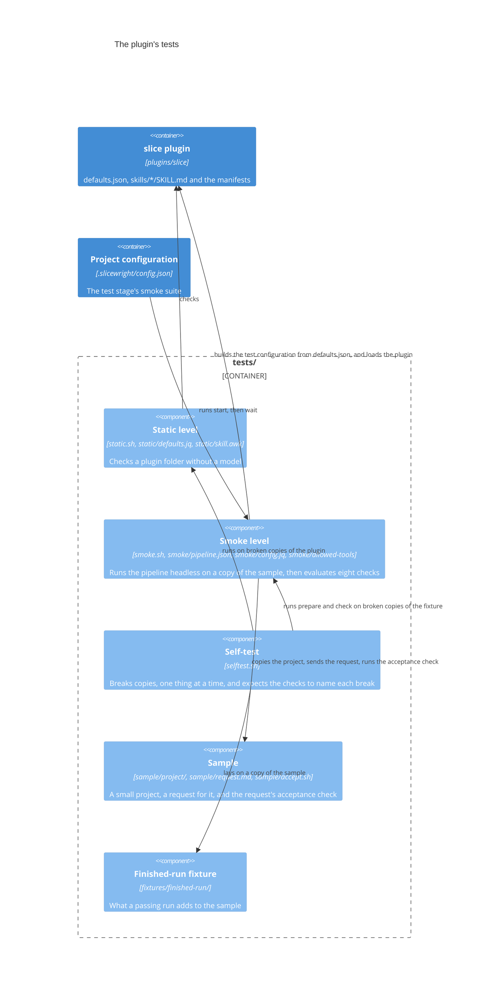

# Building blocks

The system's parts and their interfaces.

## The plugin's tests

The tests live in `tests/`, outside `plugins/slice/`, because an installed plugin is a copy of its folder. They have five parts. The plugin doesn't know about them: they read its files and run it, and nothing under `plugins/slice/` refers to them. [Testing](../overview/testing.md) gives each command's options, output and exit statuses in full.

### The parts

| Part | Files | Interface |
|---|---|---|
| Static level | `tests/static.sh`, `tests/static/defaults.jq`, `tests/static/skill.awk` | `sh tests/static.sh [<plugin folder>]`. Four checks: `validate`, `json`, `defaults` and `skills`. It prints `PASS <check>`, or `FAIL <check>: <subject>: <problem>` for each problem, and exits 0, 1, or 2 when it can't run. |
| Smoke level | `tests/smoke.sh`, `tests/smoke/pipeline.json`, `tests/smoke/config.jq`, `tests/smoke/allowed-tools` | `sh tests/smoke.sh [--minutes <n>]` runs in the foreground. The subcommands are `start [--minutes <n>]`, `wait <run folder>`, `check <run folder>` and `prepare <source folder> <run folder>`, and `_finish <run folder>` is internal. It exits 0 when every check passed, 1 when one failed, and 2 when it couldn't run. `wait` exits 3 while the run is still going. |
| Self-test | `tests/selftest.sh` | `sh tests/selftest.sh`, with no arguments. Fourteen cases: eight `static/…` and six `smoke/…`. It prints `ok`, `caught` or `MISSED` for each case, and exits 0, 1, or 2 when it can't run. |
| Sample | `tests/sample/project/`, `tests/sample/request.md`, `tests/sample/accept.sh` | The project has its own tests, `sh test.sh`, which its `AGENTS.md` names. `request.md` asks for one feature, with every choice stated. `sh tests/sample/accept.sh <project folder>` exits 0 when every case passes, 1 when one fails, and 2 on wrong usage. It is never copied into a run. |
| Finished-run fixture | `tests/fixtures/finished-run/` | An overlay on `tests/sample/project/`: only what a passing run adds or changes. The self-test copies the sample, lays the overlay on top, and runs `prepare` on the result. |

### Interfaces with the plugin

- **What the static level reads.** The manifests, through `claude plugin validate` and the `json` check. `defaults.json`, through `defaults.jq`. Each `skills/<name>/SKILL.md`'s frontmatter, through `skill.awk`.
- **The test configuration.** `prepare` builds it from the working copy's `plugins/slice/defaults.json`, with `tests/smoke/config.jq` and the stages and overrides in `tests/smoke/pipeline.json`. It writes it to the copy's `.slicewright/smoke.json`. The session uses it through `/slice:new --config smoke.json`. Each stage is the whole default stage of that name, so a change to the defaults reaches the next run with no change under `tests/`.
- **The plugin under test.** The headless session loads it only from `plugins/slice`, with `--plugin-dir`, never from `.slicewright/stable/`.
- **What the smoke checks read.** They depend on what the plugin's stages write in the copy, and on what Claude Code writes in `session.jsonl`. A change to any of these formats shows up as a failing smoke check.
  - Check 3 reads `slice/status.md`, which tracking writes: `status` and `next` in its frontmatter, and the rows of its `## Stages` table.
  - Check 4 reads the slice's records in `slice/`.
  - Check 8 reads the entry that consolidate adds to `.slicewright/slices/index.md`, which starts with `## <date> `.
  - Checks 1 and 2 read the session's `result` event and its `system` `init` event.

### Interfaces with the pipeline that develops this repo

- **The quality gates find the tests through the documentation.** Their context runs "the project's tests that need no headless Claude run, when the documentation describes any". The testing page names exactly `sh tests/static.sh` and `sh tests/selftest.sh`. No configuration names them.
- **The `smoke` suite.** One entry in the `test` stage's `testAgents` in `.slicewright/config.json`. It runs `start`, then `wait` again while it exits 3. It reports each `PASS` or `FAIL` line as one test, named after its check, and the run folder from the last line as the artifacts. A status 2 means the suite didn't start.

### The run folder

The run folder is the interface between the parts of the smoke level. The session part writes it, and `wait` and `check` read it.

- `run.txt` holds `key: value` lines, and when a key repeats, the last value counts. The foreground run and `start` write what the session part needs: `plugin_dir`, `limit_minutes`, `allowed_tools`, `started` and `smoke_pid`. The session part adds how it ended, and its cost and duration.
- `session.jsonl` and `session.err` hold the session's output.
- `checks.txt` holds the report.
- `ended` is written last, with 0 when every check passed and 1 otherwise. `wait` treats the run as ended once this file exists.

`check` writes nothing in the run folder. [Testing](../overview/testing.md) gives its full layout.
