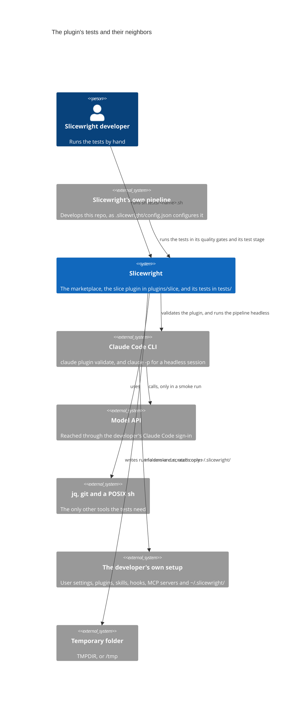

# Context

The system and its neighbors.

## The plugin's tests

The tests in `tests/` check a new version of the `slice` plugin, in the working copy's `plugins/slice`, before it is merged to `master` and becomes the stable version. [Testing](../overview/testing.md) gives their commands and output, and [Plugin tests](../product/spec/plugin-tests.md) says what they guarantee.

| Neighbor | What crosses the boundary |
|---|---|
| Slicewright developer | Runs `sh tests/static.sh`, `sh tests/selftest.sh` and `sh tests/smoke.sh` from the repo root, and reads their output. |
| Slicewright's own pipeline | The "build and tests" quality gates of `implement`, `review-fix` and `bug-fix` run `static.sh` and `selftest.sh`, because the testing page names them as the project's tests that need no headless Claude run. The `test` stage's `smoke` suite runs `smoke.sh start`, then `smoke.sh wait`. |
| Claude Code CLI | The static level runs `claude plugin validate`, a local check with no model call. The smoke level starts one headless session with `claude -p`, which runs `/slice:new` on a copy of the sample project. The smoke checks read the session's stream-json output. |
| Model API | Only the smoke level calls it, through the headless session. The cost is billed to the developer's own Claude Code sign-in. There is no cost ceiling: only the time limit bounds a run. No other network is used: no GitHub, no remote and no deployment. |
| jq, git and a POSIX sh | `jq` checks `defaults.json` and builds the test configuration. `git` puts each copy under version control. The scripts are POSIX `sh` with its standard utilities. |
| The developer's own setup | The headless session leaves out the developer's user settings, plugins, skills, hooks and MCP servers. It keeps the sign-in. The runner still reads `~/.slicewright/`, and would merge `~/.slicewright/smoke.json` into the test configuration, so the smoke command refuses to start when that file exists. |
| Temporary folder | Each smoke run writes a new run folder under `${TMPDIR:-/tmp}/slicewright-smoke/`, and keeps it. The self-test and checks 5 and 6 work in `mktemp -d` folders, and remove only those. |

The tests change nothing under `plugins/slice/` or `.slicewright/stable/`. They change only copies, in new folders outside the repo.
