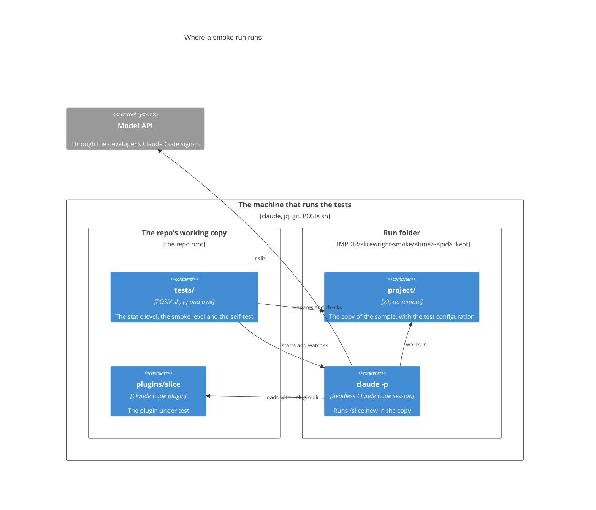

# Deployment

The system's environments and infrastructure.

## Where the plugin's tests run

The tests run on the machine where they are started: the developer's own, or the one where Slicewright's own pipeline develops this repo. There is no CI, no server and no deployment.

- **Tools.** The `claude` CLI, `jq`, `git` and a POSIX `sh` with its standard utilities. The self-test also needs `mktemp` and `cmp`. Nothing is installed.
- **Measured with** Claude Code 2.1.310 and `jq` 1.7 on macOS, where `/bin/sh` is bash in POSIX mode. Each script passes `dash -n`, and the self-test also passes under `dash`. The tests haven't been run on Linux.
- **Network.** The static level and the self-test need none. The smoke level reaches only the model API, through the developer's Claude Code sign-in: no GitHub, no remote and no deployment.

### The environments a test makes

| Environment | Where | Lifetime |
|---|---|---|
| Smoke run folder | `${TMPDIR:-/tmp}/slicewright-smoke/<YYYYMMDDTHHMMSSZ>-<pid>`, from the UTC time and the command's process ID. Never inside the repo. | Kept: no command deletes it. The OS may clear old files in `TMPDIR`. Setting `TMPDIR` for one command keeps runs elsewhere. |
| The copy | `<run>/project`: a git repository with no remote, a local identity, commit signing off, and one commit of everything. `/slice/` is in its `.gitignore`, and its test configuration is `.slicewright/smoke.json`. | Kept with the run folder. |
| The headless session | One `claude -p` process, working in `<run>/project`, with stdin from `/dev/null`. | Until the run ends, or the time limit stops it, 90 minutes by default. It isn't saved, so it can't be resumed. |
| Scratch copies for checks 5 and 6 | A `mktemp -d` folder each, outside the run folder. | Removed after the check. |
| The self-test's work folder | `mktemp -d "${TMPDIR:-/tmp}/slicewright-selftest.XXXXXX"` | Removed when every case passes. Kept, and named, otherwise. |

### The headless session's setup

- **Plugin.** Only `plugins/slice`, through `--plugin-dir`. `run.txt` records its absolute path as `plugin_dir`.
- **Settings and MCP.** `--setting-sources project,local` and `--strict-mcp-config` leave out the developer's user settings, plugins, skills, hooks and MCP servers. Claude Code's built-in plugins still load.
- **Sign-in.** The developer's own Claude Code sign-in. `CLAUDE_CONFIG_DIR` and `ANTHROPIC_*` are kept. Some variables of the calling session are unset, and `tests/smoke.sh` lists them.
- **Permissions.** `--permission-mode acceptEdits --permission-prompts none`, so every prompt is denied, and an explicit allow list: the rules in `tests/smoke/allowed-tools`, a `Skill(…)` rule for each skill the run needs, and reads of the plugin folder and of `~/.slicewright/`. `run.txt` records the list as `allowed_tools`. It never bypasses permission checks.
- **Configuration.** `/slice:new --config smoke.json`. The runner merges a user-level `~/.slicewright/smoke.json` into it, so the smoke command refuses to start when that file exists.
- **Cost.** No `--max-budget-usd` and no `--model`. Only the time limit bounds what a run spends, and `run.txt` and `checks.txt` keep its cost and duration.
