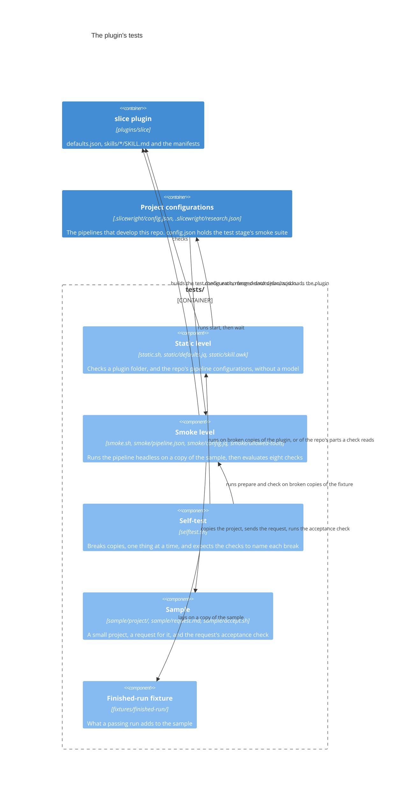
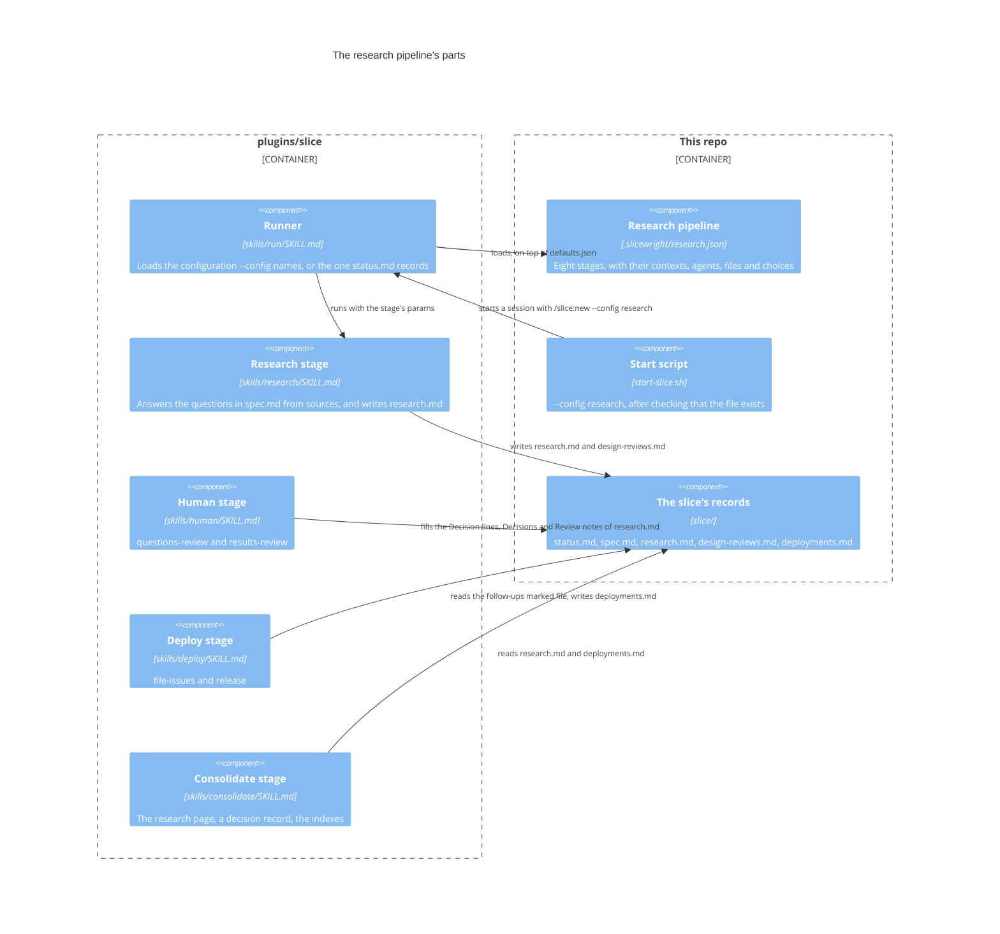

# Building blocks

The system's parts and their interfaces.

## The plugin's tests

The tests live in `tests/`, outside `plugins/slice/`, because an installed plugin is a copy of its folder. They have five parts. The plugin doesn't know about them: they read its files and run it, and nothing under `plugins/slice/` refers to them. The static level also reads this repo's own pipeline configurations. [Testing](../overview/testing.md) gives each command's options, output and exit statuses in full.

### The parts

| Part | Files | Interface |
|---|---|---|
| Static level | `tests/static.sh`, `tests/static/defaults.jq`, `tests/static/skill.awk` | `sh tests/static.sh [<plugin folder>]`. Five checks: `validate`, `json`, `defaults`, `configs` and `skills`. It prints `PASS <check>`, or `FAIL <check>: <subject>: <problem>` for each problem, and exits 0, 1, or 2 when it can't run. |
| Smoke level | `tests/smoke.sh`, `tests/smoke/pipeline.json`, `tests/smoke/config.jq`, `tests/smoke/allowed-tools` | `sh tests/smoke.sh [--minutes <n>]` runs in the foreground. The subcommands are `start [--minutes <n>]`, `wait <run folder>`, `check <run folder>` and `prepare <source folder> <run folder>`, and `_finish <run folder>` is internal. It exits 0 when every check passed, 1 when one failed, and 2 when it couldn't run. `wait` exits 3 while the run is still going. |
| Self-test | `tests/selftest.sh` | `sh tests/selftest.sh`, with no arguments. 16 cases: ten `static/…` and six `smoke/…`. Most `static/…` cases break a copy of `plugins/slice`; `static/checker` and `static/configs` break a copy of the parts of the repo the check reads, and run the copy's own `static.sh`. It prints `ok`, `caught` or `MISSED` for each case, and exits 0, 1, or 2 when it can't run. |
| Sample | `tests/sample/project/`, `tests/sample/request.md`, `tests/sample/accept.sh` | The project has its own tests, `sh test.sh`, which its `AGENTS.md` names. `request.md` asks for one feature, with every choice stated. `sh tests/sample/accept.sh <project folder>` exits 0 when every case passes, 1 when one fails, and 2 on wrong usage. It is never copied into a run. |
| Finished-run fixture | `tests/fixtures/finished-run/` | An overlay on `tests/sample/project/`: only what a passing run adds or changes. The self-test copies the sample, lays the overlay on top, and runs `prepare` on the result. |

### Interfaces with the plugin

- **What the static level reads.** The manifests, through `claude plugin validate` and the `json` check. `defaults.json`, through `defaults.jq`, and once more as the base of the `configs` check: `defaults.jq` with `--slurpfile base` merges each configuration onto it before the rules run. Each `skills/<name>/SKILL.md`'s frontmatter, through `skill.awk`.
- **The test configuration.** `prepare` builds it from the working copy's `plugins/slice/defaults.json`, with `tests/smoke/config.jq` and the stages and overrides in `tests/smoke/pipeline.json`. It writes it to the copy's `.slicewright/smoke.json`. The session uses it through `/slice:new --config smoke.json`. Each stage is the whole default stage of that name, so a change to the defaults reaches the next run with no change under `tests/`.
- **The plugin under test.** The headless session loads it only from `plugins/slice`, with `--plugin-dir`, never from `.slicewright/stable/`.
- **What the smoke checks read.** They depend on what the plugin's stages write in the copy, and on what Claude Code writes in `session.jsonl`. A change to any of these formats shows up as a failing smoke check.
  - Check 3 reads `slice/status.md`, which tracking writes: `status` and `next` in its frontmatter, and the rows of its `## Stages` table.
  - Check 4 reads the slice's records in `slice/`.
  - Check 8 reads the entry that consolidate adds to `.slicewright/slices/index.md`, which starts with `## <date> `.
  - Checks 1 and 2 read the session's `result` event and its `system` `init` event.

### Interfaces with the pipeline that develops this repo

- **The quality gates find the tests through the documentation.** Their context runs "the project's tests that need no headless Claude run, when the documentation describes any". The testing page names exactly `sh tests/static.sh` and `sh tests/selftest.sh`. No configuration names them.
- **The `smoke` suite.** One entry in the `test` stage's `testAgents` in `.slicewright/config.json`. It runs `start`, then `wait` again while it exits 3. It reports each `PASS` or `FAIL` line as one test, named after its check, and the run folder from the last line as the artifacts. A status 2 means the suite didn't start.
- **The `configs` check.** The static level reads every `.slicewright/<name>.json` of the repo the script belongs to, except `*.local.json`, merges each onto the plugin folder's `defaults.json` with the runner's rule, objects key by key at any depth, any other value replaced, `null` removes the key, and checks the result with the rules of `defaults`. So a configuration that names a stage skill the plugin folder lacks, or a `next`, `onError` or choice that names no stage, fails the static level, and a rule added to `defaults.jq` holds for every configuration. The configurations come from the repo whatever plugin folder is given: `sh tests/static.sh .slicewright/stable/plugins/slice` fails while a configuration uses a skill the stable plugin doesn't have yet.

### The run folder

The run folder is the interface between the parts of the smoke level. The session part writes it, and `wait` and `check` read it.

- `run.txt` holds `key: value` lines, and when a key repeats, the last value counts. The foreground run and `start` write what the session part needs: `plugin_dir`, `limit_minutes`, `allowed_tools`, `started` and `smoke_pid`. The session part adds how it ended, and its cost and duration.
- `session.jsonl` and `session.err` hold the session's output.
- `checks.txt` holds the report.
- `ended` is written last, with 0 when every check passed and 1 otherwise. `wait` treats the run as ended once this file exists.

`check` writes nothing in the run folder. [Testing](../overview/testing.md) gives its full layout.

## The research stage and the research pipeline

The plugin ships the `research` stage, and this repo's research pipeline runs it. The skill holds the protocol: the brief, the agent prompt and its answer form, the confidence scale, the merge, the template of `research.md`, the rerun rules and the review. The configuration holds the content: the sources, the order of trust, the citation form, what counts as evidence, what is published and whether issues are filed. [Research stage](../product/spec/research-stage.md) and [Research pipeline](../product/spec/research-pipeline.md) say what each does. Named configurations, `--config <name>`, are what lets the repo keep a second pipeline beside `config.json` ([Named configurations](../product/spec/named-configurations.md)).

### The parts

| Part | Files | Interface |
|---|---|---|
| Research stage | `plugins/slice/skills/research/SKILL.md` | The runner invokes it with the stage's params: `activeSlicePath`, `knowledge`, `context`, `researchAgents` and `reviewAgents`; it ignores any other key. It reads `spec.md`, `input.md` and an earlier `research.md`, and changes only `research.md` and `design-reviews.md`. It ends with the result block: `ok`, or `NO_SPEC`, `SPEC_NOT_READY` or `WRITE_FAILED`. Its agents answer in a fixed form: one block per question, each claim with `Source:` and a confidence, `low`, `medium`, `high` or `sure`. |
| Research pipeline | `.slicewright/research.json` | `pipeline` only, eight stages: `intake`, `clarify`, `questions-review`, `research`, `results-review`, `file-issues`, `consolidate` and `release`. Its `sharedParams` come from `defaults.json`, so `activeSlicePath` stays `./slice`. It is loaded instead of `config.json`, not on top of it, so it repeats intake's and release's contexts from there. |
| Permission rules | `.claude/settings.json` | `Skill(slice:research)`, `Bash(gh issue create:*)`, `Bash(gh issue list:*)` and `Bash(gh issue view:*)`, added to the default pipeline's rules. `/slice:configure --config research --permissions` proposes the rules the pipeline needs, from its stages' skills and the commands the `slice:deploy` contexts name. |
| Named configurations | `plugins/slice/skills/run/SKILL.md`, `plugins/slice/skills/configure/SKILL.md`, `plugins/slice/skills/tracking/SKILL.md`, `start-slice.sh` | `/slice:new [--config <name>]`, `/slice:resume [--config <name>]`, `/slice:configure [--config <name>] [--permissions]` and `sh start-slice.sh [--config <name>] [<issue number>]`. `<name>` is a plain file name, `.json` added when it doesn't end in it; a name with `/` or `..` stops the command. The runner and configure read `defaults.json`, `~/.slicewright/<file name>`, `.slicewright/<file name>` and `.slicewright/<local variant>`, and one of the last three must exist for a name other than `config.json`. Tracking records `config: <file name>` in `status.md` for any name but `config.json`, and the runner reads it back on resume and on **Continue**. |

### Interfaces through `research.md`

`research.md` is the interface between the research stage, the `results-review` gate, `file-issues` and the consolidate agents. Each writes or reads a fixed part of it:

- **The research stage** writes the whole file, and on a later run keeps what the others wrote: every line under `## Decisions`, every filled `Decision:` line, and the `## Review notes` it hasn't applied yet. It leaves `Decision:` empty under Recommendation and after each follow-up, and matches questions and follow-ups by their text, not their number, so a re-scope that renumbers the questions loses nothing.
- **`results-review`** writes into it: the decision in the person's words, or `none: <why>`, on the recommendation's `Decision:` line; `Decision: file` or `Decision: no issue` on each follow-up's; one line under `## Decisions` for each open question answered; and, before `more-research`, one line under `## Review notes` for each request. These words are the pipeline's choice, made in its `results-review` context: the skill keeps any filled line as it is, whatever it says.
- **`file-issues`** reads each follow-up, `- **F<n>** <title>: <what, and why it matters>`, whose `Decision:` is `file`. The title, the text between the id and the first colon, is the issue's title and the key of the exact-title search. It records the issue URLs, each with its follow-up's id, as the endpoint of its entry in `deployments.md`.
- **The `research` knowledge agent** reads `research.md` and the latest `deployments.md` entry whose endpoint lists issue URLs, and writes `architecture/research/<name>.md`, where `<name>` is the slice's title as a slug: lowercase, words as runs of letters and digits, joined with `-`, the way a records folder is named for a slice without an id. **The `adr` agent** writes a decision record only when the recommendation's `Decision:` is filled and doesn't start with `none`, and links the staged research page; it runs after the `research` agent, so the page exists when it starts.
