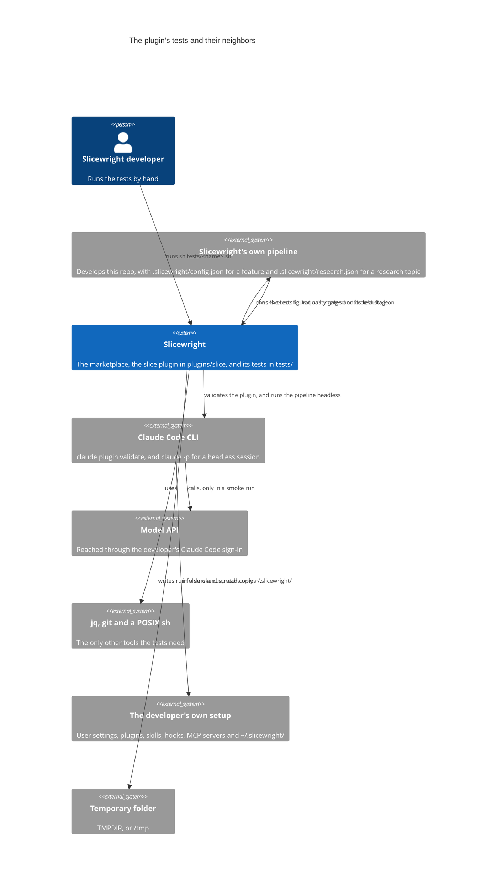
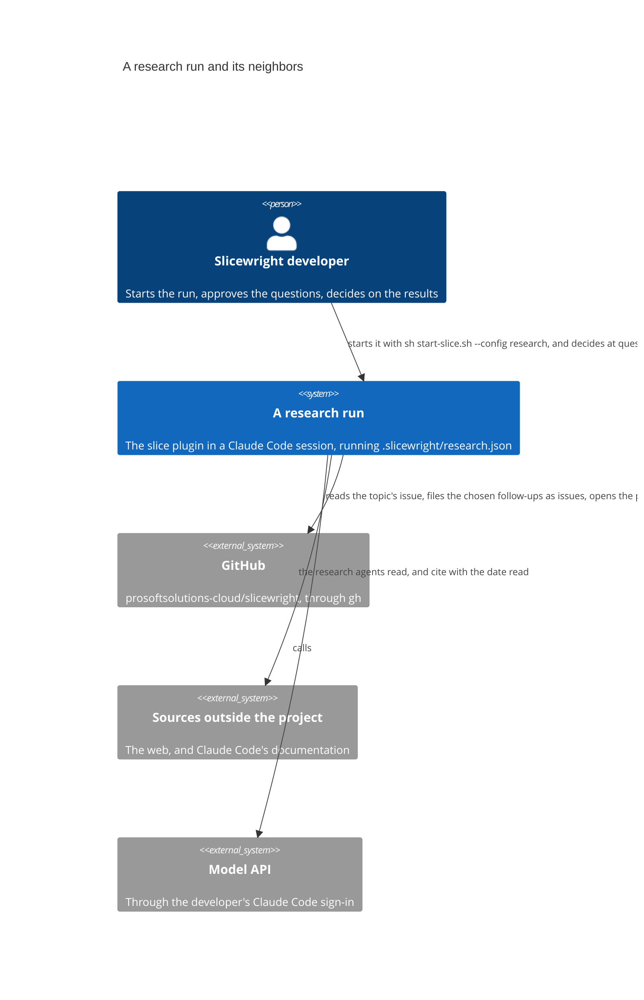

# Context

The system and its neighbors.

## The plugin's tests

The tests in `tests/` check a new version of the `slice` plugin, in the working copy's `plugins/slice`, and this repo's pipeline configurations with it, before it is merged to `master` and becomes the stable version. [Testing](../overview/testing.md) gives their commands and output, and [Plugin tests](../product/spec/plugin-tests.md) says what they guarantee.

| Neighbor | What crosses the boundary |
|---|---|
| Slicewright developer | Runs `sh tests/static.sh`, `sh tests/selftest.sh` and `sh tests/smoke.sh` from the repo root, and reads their output. |
| Slicewright's own pipeline | The "build and tests" quality gates of `implement`, `review-fix` and `bug-fix` in `config.json` run `static.sh` and `selftest.sh`, because the testing page names them as the project's tests that need no headless Claude run. The `test` stage's `smoke` suite runs `smoke.sh start`, then `smoke.sh wait`. The research pipeline has no stage that runs them. In the other direction, the static level's `configs` check reads the pipeline's configurations, every `.slicewright/<name>.json` except `*.local.json`, and checks each merged onto the plugin folder's `defaults.json`, so a configuration that names a stage skill the plugin lacks fails the static level. |
| Claude Code CLI | The static level runs `claude plugin validate`, a local check with no model call. The smoke level starts one headless session with `claude -p`, which runs `/slice:new` on a copy of the sample project. The smoke checks read the session's stream-json output. |
| Model API | Only the smoke level calls it, through the headless session. The cost is billed to the developer's own Claude Code sign-in. There is no cost ceiling: only the time limit bounds a run. No other network is used: no GitHub, no remote and no deployment. |
| jq, git and a POSIX sh | `jq` checks `defaults.json` and the configurations, and builds the test configuration. `git` puts each copy under version control. The scripts are POSIX `sh` with its standard utilities. |
| The developer's own setup | The headless session leaves out the developer's user settings, plugins, skills, hooks and MCP servers. It keeps the sign-in. The runner still reads `~/.slicewright/`, and would merge `~/.slicewright/smoke.json` into the test configuration, so the smoke command refuses to start when that file exists. |
| Temporary folder | Each smoke run writes a new run folder under `${TMPDIR:-/tmp}/slicewright-smoke/`, and keeps it. The self-test and checks 5 and 6 work in `mktemp -d` folders, and remove only those. |

The tests change nothing under `plugins/slice/`, `.slicewright/stable/` or `.slicewright/`. They read the repo's `.slicewright/*.json`, and change only copies, in new folders outside the repo.

## A research run

This repo's research pipeline, `.slicewright/research.json`, runs a research topic through the `slice` plugin the way `config.json` runs a feature, with the plugin's `research` stage in the middle. It leaves a research page and, when a decision was taken, a decision record in `doc/`, the slice's records in `.slicewright/slices/`, and a pull request. [Research pipeline](../product/spec/research-pipeline.md) says what each stage does, and [Research stage](../product/spec/research-stage.md) what the stage does. A research run has neighbors a feature slice doesn't: it reads sources outside the project, it files issues, and a person decides at two of its gates.

| Neighbor | What crosses the boundary |
|---|---|
| Slicewright developer | Starts the run with `sh start-slice.sh --config research <issue number>`, which checks that `.slicewright/research.json` exists and starts a session with `/slice:new --config research <issue number>`. At `questions-review` they approve the questions in `spec.md`. At `results-review` they answer the open questions, decide on the recommendation and on each follow-up, and choose `accept`, `more-research`, `re-scope` or `drop`. A person is always at these gates, so the pipeline never runs headless, and the smoke test doesn't cover it. |
| GitHub | Through `gh`, on `prosoftsolutions-cloud/slicewright`. `intake` reads the topic's issue. `file-issues` looks for an issue with each chosen follow-up's exact title, open or closed, creates the missing ones, and checks each with `gh issue view`. `release` pushes the branch and opens or updates the pull request. `.claude/settings.json` allows `gh issue create`, `gh issue list` and `gh issue view` for this, besides the `gh pr` commands and `Skill(slice:research)`. |
| Sources outside the project | The `web` research agent searches the web and reads the primary sources it finds, never only a search result's summary. The `claude-code` agent, of the `claude-code-guide` type, answers from Claude Code's documentation what concerns Claude Code, its plugins, skills, hooks, subagents and settings, the Claude Agent SDK and the Claude API. A page is cited as its link with the date it was read, a file in the project as its path. The order of trust runs from the project's own code and documentation, through the primary source for a matter and a secondary source that reports it, to a vendor's marketing. No rule in `.claude/settings.json` pre-allows the web tools, so the session may ask the person. A source that can't be reached becomes an assumption in `research.md`, not a failure. |
| Model API | Every stage calls it, through the developer's Claude Code sign-in. |
| The stable plugin | `start-slice.sh` starts the session with the plugin in `.slicewright/stable/plugins/slice`, the worktree at `origin/master`, not the working copy's. So a research run uses the `research` stage only once a version that has it is on `master`. |
