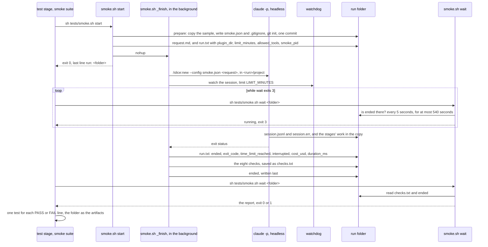
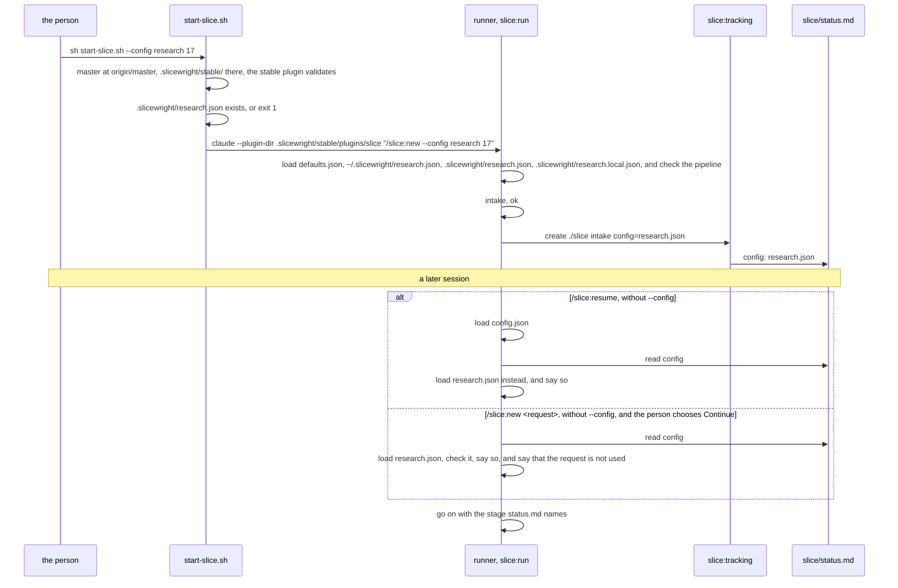
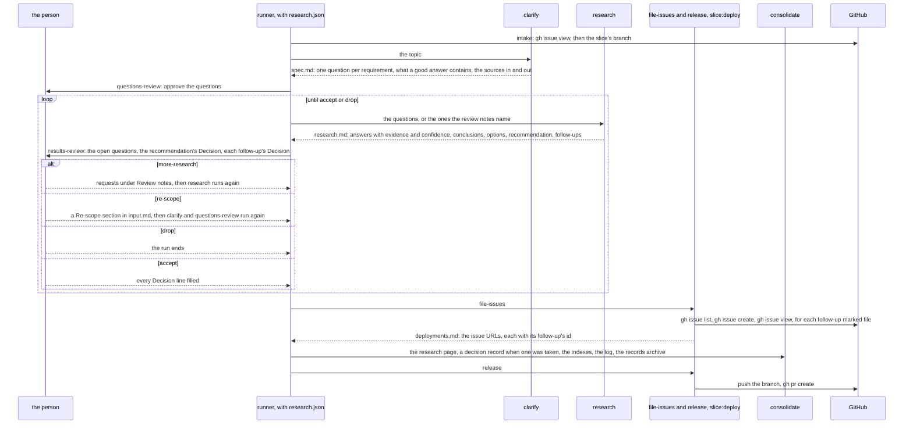

# Runtime

The system's key flows.

## A smoke run in the test stage

A smoke run takes longer than one shell command may last, so the `test` stage's `smoke` suite doesn't wait for it in one call. `start` returns at once, and the session goes on in the background. `wait` blocks for at most `WAIT_SECONDS`, 540 seconds, and the suite runs it again while it exits 3. [Testing](../overview/testing.md) gives each command's output.

- The foreground run, `sh tests/smoke.sh`, does the same work in one process: it runs the session part itself instead of starting `_finish`, and prints the report when the session ends.
- `start` and the foreground run refuse to start, with exit 2, when `~/.slicewright/smoke.json` exists, or when the run folder would be inside the repo.
- Before the session starts, the session part unsets some variables of the calling session, which `tests/smoke.sh` lists. A run from a stage's agent then doesn't inherit that session's effort or messaging socket.

## The time limit and an interrupt

- A watchdog checks the session every 5 seconds. At the limit, it writes `<run>/timed-out`, sends TERM, and sends KILL 30 seconds later if the session is still alive.
- The session part then records `time_limit_reached: yes`. Check 1 fails, and the report says that the time limit stopped the session.
- A foreground run that gets INT or TERM records `interrupted: yes`, and stops the session the same way: TERM now, and KILL 30 seconds later. It still evaluates the checks and prints the report.

## A background run that stopped without finishing

When `ended` is missing and the process recorded as `smoke_pid` is gone, the background part died before it finished.

1. `wait` says so, and evaluates the checks now.
2. It records the run as ended, as the session part does: it adds `cost_usd` and `duration_ms` to `run.txt`, each `unknown` when the session didn't report it, and saves the report as `checks.txt`.
3. It writes `ended` last, and exits as the report says: 0 when every check passed, 1 otherwise.

A later `wait` finds `ended`, prints the saved report, and exits the same way. A folder with no `smoke_pid`, such as one that only `prepare` made, gets the report and exit 1, and `wait` writes nothing in it.

## Evaluating the checks

- The eight checks run in order on the files the run left. Each prints one `PASS` or `FAIL` line.
- Checks 5 and 6 each run in a scratch copy of the project, made with `mktemp -d`. The same watchdog limits each to `CHECK_SECONDS`, 120 seconds. The scratch copy is removed afterwards. So the kept copy doesn't change, and the order of the checks doesn't matter.
- `sh tests/smoke.sh check <run folder>` evaluates the checks again on a kept run. It starts no session and writes nothing in the run folder.

## The static level and the self-test in a quality gate

The "build and tests" quality gates of `implement`, `review-fix` and `bug-fix` read the testing page, and run the two tests it names as needing no headless Claude run.

1. `sh tests/static.sh` runs its five checks: `validate`, `json`, `defaults` and `skills` on `plugins/slice`, and `configs` on every `.slicewright/<name>.json` of the repo except `*.local.json`, each merged onto `plugins/slice/defaults.json` and checked with the rules of `defaults`. Its only `claude` calls are the two local validations.
2. `sh tests/selftest.sh` makes one work folder with `mktemp -d`. For each case, it:
   1. makes a copy: of `plugins/slice` for most `static/…` cases; for `static/checker` and `static/configs`, of the parts of the repo the check reads, the manifests, the plugin, `static.sh` and `tests/static/`, and for `static/configs` also `.slicewright/research.json`; or, for a `smoke/…` case, of the sample with the fixture laid on top, through `smoke.sh prepare`;
   2. breaks one thing in the copy, and checks that the break changed something, or reports the case as `MISSED`;
   3. runs `static.sh`, the copy's own for the two cases that copy the repo's parts, or `smoke.sh check`, on the copy;
   4. looks for the line that names what broke.

   It removes its work folder only when every case passes. Otherwise it keeps the folder and prints `kept: <folder>`.

Neither starts a Claude session, and each finishes within 60 seconds. The smoke test never runs in a quality gate or a task's Verify.

## A slice with a named configuration

A project can keep more than one pipeline, one per `.slicewright/<name>.json`, and a slice remembers the one it runs with: `--config <name>` picks it, and `status.md` carries it to the next session. [Named configurations](../product/spec/named-configurations.md) gives the rules. The smoke run loads its test configuration this way, as `/slice:new --config smoke.json`, and this repo's research pipeline is started this way, as below.

- Without `--config`, the name is `config.json`, and nothing is recorded: `status.md` has a `config:` line only for another configuration.
- With `--config` given, on `/slice:resume` or on `/slice:new`, the given configuration is kept, whatever `status.md` records.
- With a name other than `config.json`, at least one of `~/.slicewright/<file name>`, `.slicewright/<file name>` and `.slicewright/<local variant>` must exist, or the runner stops and names the three. `start-slice.sh` checks only the project's file, `.slicewright/<name>.json`, before Claude starts.
- **Start new** deletes the slice folder and starts the typed request with the configuration loaded, so `/slice:new` without `--config` then runs `config.json`.
- When the stage to go on with isn't in the loaded pipeline, because the configuration changed, the runner says so and stops.

## A research topic through the research pipeline

The research pipeline, `.slicewright/research.json`, has eight stages and two gates where a person decides. [Research pipeline](../product/spec/research-pipeline.md) gives each stage's context in full; this is the flow.

- `research` has `onError: results-review`, so a failure, `NO_SPEC`, `SPEC_NOT_READY` or `WRITE_FAILED`, is put to the person. `accept` isn't open then, and a failure in the spec itself is fixed through `re-scope`, not `more-research`.
- `more-research` runs `research` again. The person's requests are lines under `## Review notes`; the stage reworks what they name, keeps the rest of the document, and removes the notes.
- `re-scope` runs `clarify` again, with a `## Re-scope` section appended to `input.md`, then `questions-review`. The next research run matches questions by their text, so renumbering loses nothing.
- `drop` ends the run: its choice maps to no stage.
- `file-issues` runs before `consolidate`, so that the research page carries the issue links from `deployments.md`.
- `consolidate`'s three knowledge agents run in order: `research` stages `architecture/research/<name>.md`, and updates it under the same name on a later consolidation; `adr` stages a decision record when the recommendation's `Decision:` is filled and doesn't start with `none`, and links the staged page; `index` updates the indexes, lists a new folder under Contents in its parent's `index.md`, and adds the entry to `log.md`.
