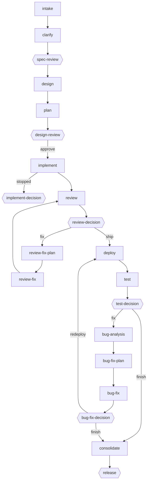

# Slicewright

An AI agent can write a feature in one go, but the result is hard to trust: the spec was never written down, nobody checked the design, the tests ran against nothing, and the documentation falls behind.

Slicewright runs one feature at a time, a *slice*, through the steps a careful team would take: a spec with acceptance criteria, a design and a plan, implementation in small tasks with quality gates, review by separate agents, deployment and tests, root-cause bug fixing, and documentation. Every step leaves a record, and a person decides at each gate. Every stage, agent and rule is configurable.

Status: 0.1.0, experimental.

## Install

In Claude Code:

```text
/plugin marketplace add prosoftsolutions-cloud/slicewright
/plugin install slice@slicewright
```

## Requirements

- Claude Code. Slicewright is tested with 2.1.310.
- A project under version control. The default configuration checks at the start that the sources are clean and current, and commits the documentation and the slice's records at the end.
- Permission rules for the stages' skills and commands, so a run doesn't stop at every prompt. `/slice:configure` proposes them.

**Cost and time.** In our test runs on a small sample project, a notes API, with Sonnet, the stages of a slice with one small feature added up to about $6 to $8 and 20 to 30 minutes of agent time, plus the time a person spends at the gates. Each round of review fixes added about $2.50, and each bug-fix iteration, with its redeploy and test run, about $3 to $5. Expect more for a bigger project or feature, or a larger model.

## Quick start

1. `/slice:configure` creates `.slicewright/config.json` from the defaults, sets up the project's documentation, and proposes the permission rules.
2. `/slice:new <feature request>` starts a slice in `./slice` and runs the pipeline. At each gate it asks you in the conversation.
3. `/slice:resume` continues when the run has stopped: after an error, a pause, or a closed session.

`/slice:new` and `/slice:resume` take `--config <name>` to use another configuration.

## The pipeline



The hexagons are gates, where you decide. A gate can also send the slice back to the plan or the design, run a stage again, or stop.

1. **Start:** `intake` resolves the request, and `clarify` writes the spec, which **spec-review** puts to you.
2. **Design:** `design` and `plan` write the design and the tasks, then **design-review**: approve, re-plan or re-design.
3. **Build:** `implement` works through the tasks one by one, with quality gates. When it stops, **implement-decision**.
4. **Review:** `review` runs the reviewers, then **review-decision**: fix, ship, re-plan or re-design. Fixes go through `review-fix-plan`, `review-fix` and **review-fix-decision**.
5. **Verify:** `deploy` and `test`, then **test-decision**: fix, finish, retry or redeploy.
6. **Fix bugs:** `bug-analysis` finds the root causes with the configured instruments, `bug-fix-plan` and `bug-fix` fix them, then **bug-fix-decision** shows each iteration's results, so you can see whether the loop is converging.
7. **Finish:** `consolidate` publishes the documentation and keeps the slice's records. **release** stands in until the project configures its own release steps.

## Concepts

- **Slice:** one feature, small enough to go through the whole pipeline. Its files live in `./slice` while it runs, and its records in `.slicewright/slices/` after it is consolidated.
- **Stage:** one step of the pipeline, a skill with its params. It runs `inline`, in the conversation, or as a `fork`, in a subagent.
- **Gate:** a stage where a person decides, run by `slice:human`. Its `choices` say where the pipeline goes next.
- **Context:** plain-language rules for a stage or an agent. The skill is the protocol, and the context is what this project wants.
- **Agents:** stages hand parts of their work to configured agents, each with a `name`, how it runs, and a `context`:
  - reviewers (`reviewAgents`)
  - quality gates that build and test (`qualityGateAgents`)
  - test agents (`testAgents`)
  - instruments that investigate failures (`instrumentAgents`)
  - knowledge agents that update the documentation (`knowledgeAgents`)
  - design agents (`designAgents`)
- **Task types:** the kinds of work a plan splits a feature into, each with its own rules, in `sharedParams.taskTypes`. The defaults are infrastructure, data storage, backend, frontend, end-to-end tests and documentation.
- **Result:** every stage ends with `result: ok`, `skipped` or `error`, and the runner picks the next stage from it. `status.md` records each one.

## What a slice leaves behind

| File in `./slice` | Written by | Read by |
|---|---|---|
| `status.md` | the runner, after each stage | `/slice:resume`, and you |
| `input.md` | `intake`: the request, resolved | every stage |
| `spec.md` | `clarify`, and spec-review with your answers | design, plan, review, bug analysis |
| `design.md` | `design`, and the gates with their review notes | plan, review, bug analysis |
| `plan.md`, `tasks/` | `plan`: the tasks, each with its files and checks | implement |
| `design-reviews.md` | `clarify`, `design` and `plan`: their reviewers' rounds | spec-review, design-review |
| `implement.md` | `implement`: each run, with its tasks and quality gates | review, consolidate |
| `code-reviews.md` | `review`: each round's findings, with your decisions | review-decision, review-fix-plan |
| `review-round-<n>.md` | `review-fix-plan`: the fixes for round n | review-fix |
| `deployments.md` | `deploy`: what was deployed, where | test, bug analysis |
| `test-reports.md` | `test`: each run, with your decision on each failed test | test-decision, bug analysis |
| `bug-analyses.md` | `bug-analysis`: the root causes, round by round | bug-fix-plan, bug-fix-decision |
| `bug-round-<n>.md` | `bug-fix-plan`: the fixes for round n | bug-fix |
| `docs/` | the stages that change documentation: the pages this slice changed | every stage. `consolidate` publishes them. |

## Configuration

Four files are merged in order:

1. the plugin's `defaults.json`
2. `~/.slicewright/config.json`: yours, for every project
3. `.slicewright/config.json`: the project's, committed
4. `.slicewright/config.local.json`: yours, for this project, not committed

Objects merge key by key, any other value replaces the earlier one, and `null` removes a key. A list replaces the earlier list as a whole, so a project's `pipeline` replaces the default one. That's why `/slice:configure` copies the whole default pipeline into `.slicewright/config.json`: you change the stages there.

The top level has `sharedParams`, which every stage receives, and `pipeline`, the stages in order. Each stage names its `skill`, its `executionMode`, the stage to go to `next` and `onError`, and its `params`. [`defaults.json`](plugins/slice/defaults.json) shows every stage's params.

### Recipes

**Deploy.** Set the `deploy` stage's context in `.slicewright/config.json`:

```json
{
  "name": "deploy",
  "skill": "slice:deploy",
  "executionMode": "fork",
  "params": {
    "context": "Run `make deploy-staging`. Then check that https://staging.example.com/health answers 200."
  }
}
```

**Tests.** Add an agent to the `test` stage's `testAgents`:

```json
{
  "name": "smoke",
  "agent": "general-purpose",
  "executionMode": "fork",
  "context": "Run `npm run test:smoke` against the deployment given below."
}
```

**Documentation elsewhere.** Point `sharedParams.knowledge` at a source that a skill reaches, such as a wiki:

```json
{
  "sharedParams": {
    "knowledge": {
      "publishTo": "wiki",
      "sources": [
        {
          "name": "wiki",
          "skill": "<plugin>:<skill that reads and publishes pages>",
          "context": "The team's space ENG. Start at its home page."
        }
      ]
    }
  }
}
```

The contexts of `consolidate`'s `knowledgeAgents` say where each kind of page goes: change them to match your structure.

**Release.** Replace the `release` stage with the steps it takes:

```json
{
  "name": "release",
  "skill": "slice:deploy",
  "executionMode": "fork",
  "params": {
    "context": "Push the slice's branch and open a pull request with the slice's title. Then comment on the ticket in input.md with the link."
  }
}
```

**Drop a stage.** Remove it from `pipeline`, and change every `next`, `onError` and gate choice that names it. The runner checks `next` and `onError` before it starts, and lists what's wrong.

**Another pipeline.** `--config hotfix` loads `hotfix.json` from the same places instead of `config.json`, for example a shorter pipeline in `.slicewright/hotfix.json`.

## Documentation

Every stage reads the project's documentation, and the pipeline keeps it current. `sharedParams.knowledge` lists the documentation sources, each a folder in the project or a skill that reaches one elsewhere, and names the one a slice publishes to.

While a slice runs, its documentation changes are staged in `./slice/docs/`. `consolidate` publishes them, keeps the slice's records in `.slicewright/slices/`, and keeps a short pointer to the documentation in the project's `AGENTS.md`.

By default the documentation is an OKF bundle in `./doc`, with the architecture in arc42.

## Limitations

- It's experimental: the skills and the defaults still change between versions.
- One slice at a time per working copy, because the slice lives in `./slice`. To run slices in parallel, use a working copy or a worktree for each.
- The reviewers and quality gates are agents too. The gates where a person decides are what makes the result trustworthy.
- A headless run can't answer permission prompts: allow what the stages need up front.
- The defaults assume a project that builds and tests from the command line. Other setups need their own contexts.

## License

[Apache License 2.0](LICENSE)
